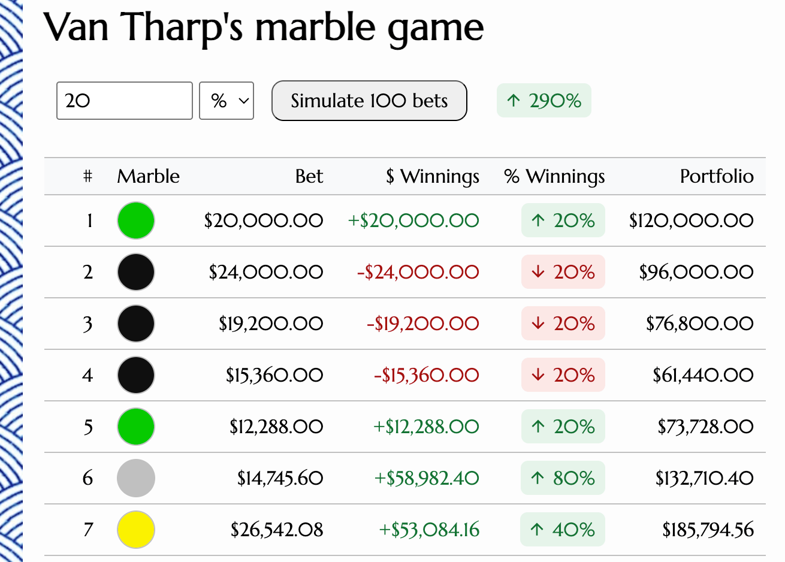

# Van Tharp's Marble Game

A browser-based simulator for the Van Tharp Marble Game, illustrating how **position sizing** — not just win rate — drives trading outcomes.

The game is described in the book [Trading Beyond the Matrix](https://www.amazon.com/Trading-Beyond-Matrix-Traders-Investors/dp/1118525663) by Van K. Tharp.

Checkout the [live demo](https://evoluteur.github.io/van-tharp-marble-game/).



## How it works

You start with a **$100,000** portfolio. On each of 100 draws, a marble is pulled at random from a bag of 100, and its color determines your payout multiple (`x`) on the amount you bet:

| Probability | Color  | Multiple (x) |
|-------------|--------|---------------|
| 65% | black  | 0  |
| 15% | blue   | 1  |
| 7%  | green  | 2  |
| 6%  | yellow | 3  |
| 3%  | silver | 5  |
| 2%  | gold   | 10 |
| 2%  | pink   | 20 |

Before running the simulation, choose how much to bet on each draw:
- **$ amount** — a fixed dollar amount every round.
- **% of portfolio** — a percentage of your *current* portfolio value, so bet size compounds as the portfolio grows or shrinks.

Click **Simulate 100 bets** to run the sequence and see the running results, per-round breakdown, and final portfolio outcome. Re-run with different sizing to see how the same odds can lead to wildly different results — from steady growth to blowing up the account — depending purely on how much you risk per bet.

## Running locally

No build step or dependencies — it's plain HTML, CSS, and JavaScript. Just serve the folder and open it in a browser, e.g.:

```bash
npx serve .
# or
python3 -m http.server
```

Then visit the printed local URL.

## Project structure

```
index.html         Page markup and SEO/meta tags
css/vtmg.css        Styling
js/vtmg.js          Game logic, simulation, and rendering
js/vtmg-config.js   Simulation config (starting capital, style)
js/vtmg-meta.js     Site/app metadata
```

## Tech stack

Plain HTML, CSS, and JavaScript — no frameworks, build tools, or external dependencies.

## License

Open Source at [GitHub](https://github.com/evoluteur/van-tharp-marble-game) under the [MIT license](LICENSE).

(c) 2026 [Olivier Giulieri](https://evoluteur.github.io/)
